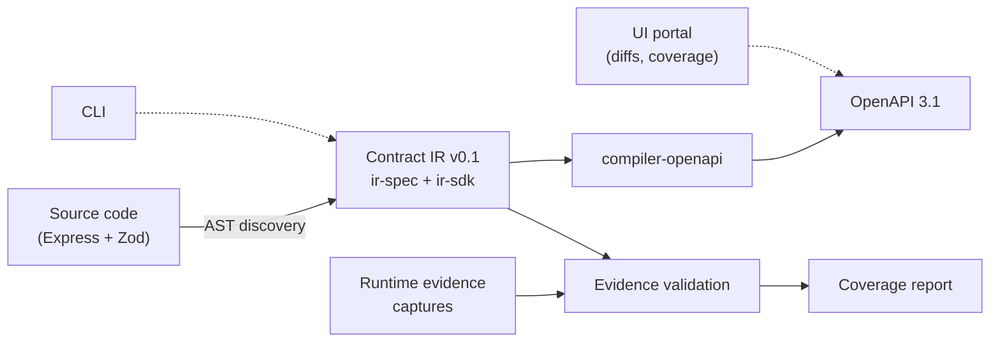

# API Contract Platform

A production-grade platform for extracting, validating, and compiling API contracts from source code.

## Vision

**Stop maintaining OpenAPI specs by hand.** Extract contracts from your code, validate them automatically, and compile to industry-standard formats.

```
Express + Zod  →  Contract IR  →  OpenAPI 3.1
FastAPI        →  Contract IR  →  AsyncAPI
Go + Chi       →  Contract IR  →  ...
```

## How it works



## Quick Start

```bash
# Install dependencies
pnpm install

# Run all checks (lint + typecheck + test + build + evidence validation)
pnpm check

# Or run individual checks
pnpm lint
pnpm typecheck
pnpm test
pnpm build

# Use the CLI
pnpm docsmyth validate fixtures/contract-ir/v0.1/minimal-http.json
pnpm docsmyth compile fixtures/contract-ir/v0.1/minimal-http.json --out ./output
```

## Evidence Validation

Validate contract evidence from runtime captures:

```bash
# Validate with valid evidence (should pass, prints coverage report)
pnpm evidence:valid

# Validate with invalid evidence (expected to fail - used as negative test)
pnpm evidence:invalid
```

> **Note:** `pnpm evidence:invalid` is a **negative test** and is expected to fail.
> CI uses this to verify that invalid evidence is correctly rejected.

## Project Structure

```
api-contract-platform/
├── packages/
│   ├── ir-spec/           # Contract IR types & validation
│   ├── ir-sdk/            # Builder helpers for IR
│   ├── compiler-openapi/  # IR → OpenAPI 3.1 compiler
│   └── cli/               # Command-line interface
├── examples/
│   └── express-zod/       # Example Express + Zod app
├── fixtures/
│   ├── contract-ir/       # IR fixture files
│   └── openapi/           # Expected OpenAPI outputs
└── docs/
    └── rfcs/              # Design documents
```

## Packages

| Package                 | Description                                              |
| ----------------------- | -------------------------------------------------------- |
| `@docsmyth/ir-spec`          | Contract IR v0.1 TypeScript types and validation         |
| `@docsmyth/ir-sdk`           | Builder functions for constructing IR programmatically   |
| `@docsmyth/compiler-openapi` | Compiles Contract IR to OpenAPI 3.1                      |
| `@docsmyth/cli`              | Command-line tool (`acp`) for validation and compilation |

## Development

### Prerequisites

- Node.js 20+
- pnpm 9+

### Commands

```bash
# Install all dependencies
pnpm install

# Build all packages
pnpm build

# Run tests
pnpm test

# Lint code
pnpm lint

# Format code
pnpm format

# Type check
pnpm typecheck
```

### Adding a new package

1. Create directory under `packages/`
2. Add `package.json` with `@docsmyth/` scope
3. Add `tsconfig.json` extending `../../tsconfig.base.json`
4. Add reference to root `tsconfig.json`
5. Add to `pnpm-workspace.yaml` if not using `packages/*` glob

## Documentation

- [RFC 0001: Contract IR v0.1](./docs/rfcs/0001-contract-ir-v0.1.md)
- [RFC 0002: Evidence Model v0.1](./docs/rfcs/0002-evidence-model-v0.1.md)
- [RFC 0003: Week 1 Scope](./docs/rfcs/0003-week1-scope-and-decisions.md)
- [Release Guide](./docs/release.md)
- [Smoke Pack Testing](./docs/smoke-pack.md) - Comprehensive smoke test for package publishing

## Roadmap

### Week 1 (Current) ✅

- Monorepo scaffolding
- Package stubs
- CI pipeline
- RFC documentation

### Week 2

- Full IR validation (JSON Schema)
- Express+Zod extraction (basic)
- Evidence model implementation

### Week 3

- Enhanced extraction (more patterns)
- Contract diffing
- IDE integration exploration

### Week 4

- Additional framework support
- npm publishing
- Documentation site

## License

MIT – see [LICENSE](./LICENSE)

## Contributing

See [CODEOWNERS](./CODEOWNERS) for team ownership. Contributions welcome!
